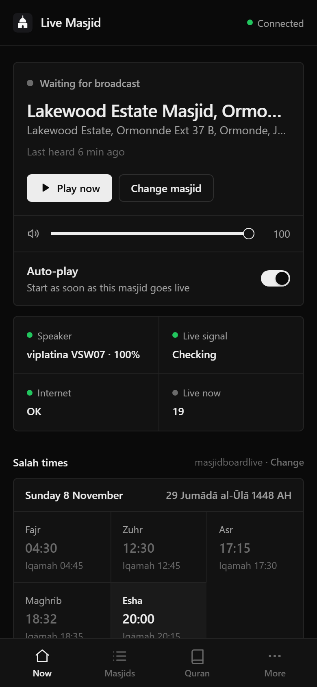
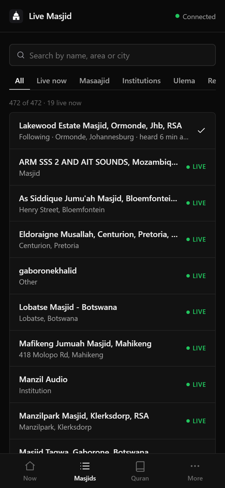
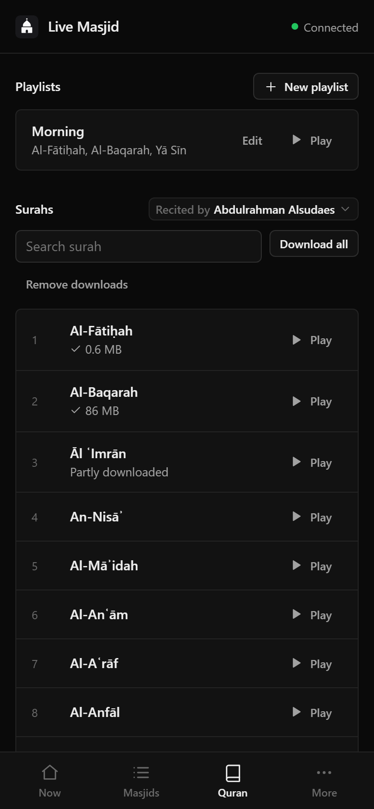
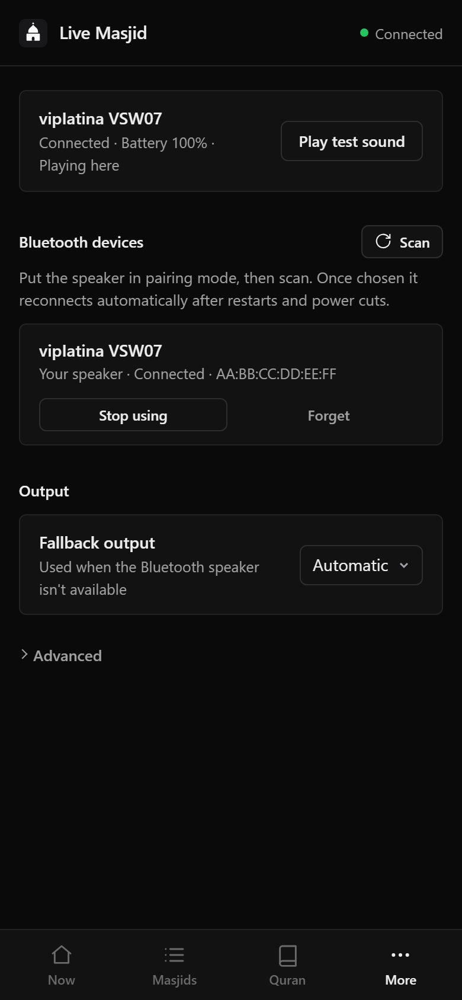
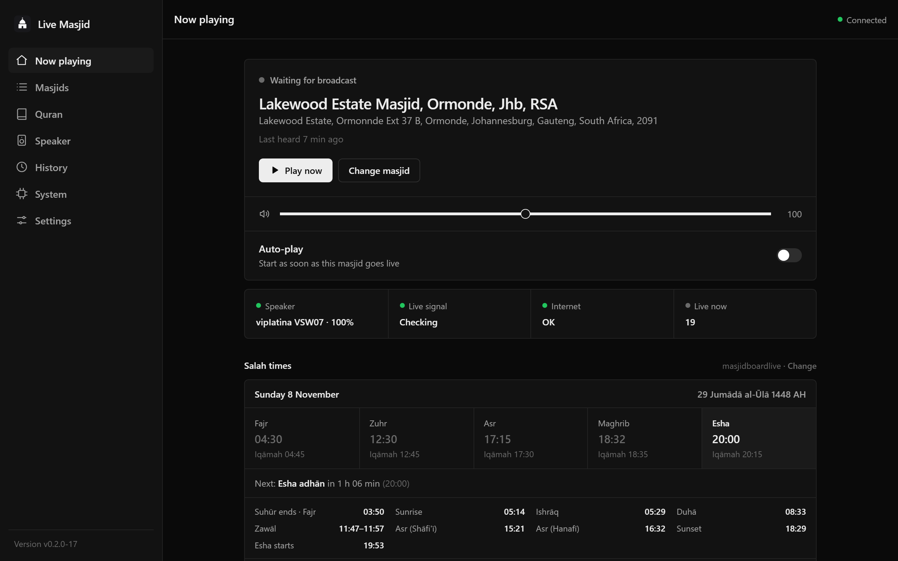
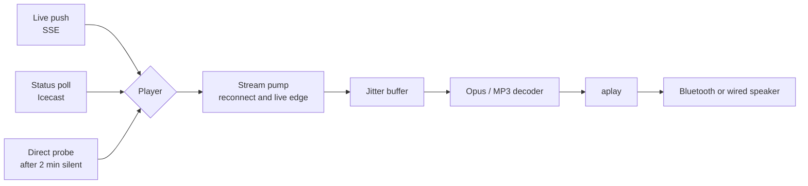

<div align="center">


# Live Masjid Pi

**An always-on masjid radio for the Raspberry Pi.**<br>
Pick your masjid once. When it goes live, the audio starts on your speaker, with nobody opening a page.

[](https://github.com/MAYasin/Live-Masjid/releases/latest)
[](https://github.com/MAYasin/Live-Masjid/actions/workflows/release.yml)
[](LICENSE)


[Set up a device](docs/SETUP.md) · [How it works](#how-it-decides-to-play) · [Features](#features) · [Updates](#updates) · [Security](SECURITY.md)

</div>

<br>

<p align="center">
  
  
  
  
</p>

An always-on player for [livemasjid.com](https://www.livemasjid.com) streams, built for a **Raspberry Pi Zero 2 W**.
Whenever your masjid goes live, audio starts on your Bluetooth speaker (or a wired output). It carries on after reboots,
power cuts and network drop-outs.

- **Tiny.** One static Rust binary of about 3 MB, using about 4 MB of RAM and 1–2% CPU while playing.
- **No dependencies** beyond `aplay` (alsa-utils), `bluetoothctl` (BlueZ) and bluez-alsa. No Docker.
- **Manage it from any phone or computer.** The web UI updates live and installs to your home screen.
- **Looks after itself.** It reconnects the speaker, recovers a hung Bluetooth chip, and updates itself with automatic rollback.

## Features

| | |
|---|---|
| 🔴 **Auto-play** | Starts the moment the masjid goes live, about half a second after the signal, and joins at the live edge instead of replaying the buffered burst |
| 🔊 **Bluetooth first** | Pairs, reconnects and re-pairs by itself, shows the speaker's battery, and falls back to USB or HDMI audio |
| 🕌 **470+ masjids** | Searchable directory with live badges. Follow one, or listen to any of them on demand |
| 🕓 **Salah times** | Adhān and iqāmah, Jumu'ah, upcoming changes, the Hijri date and a countdown to the next salah |
| 🎙️ **Recordings** | Play past broadcasts of any masjid on the speaker. A live broadcast always takes over |
| 📖 **Quran** | About 240 reciters, playlists with repeat and weekly schedules, downloaded to the Pi for offline playback |
| 🎧 **Listen in the browser** | Optionally hear the stream on your phone, in sync with the speaker or at the lowest delay |
| 🔄 **Self-updating** | Hourly check, signed releases, health check and rollback. Update from **System → App** |

<details>
<summary><b>Desktop view</b></summary>
<br>

</details>

## Get started

You need a Pi, a microSD card and a speaker. Setup takes about 20 minutes, and almost all of it is automated.

| Step | What to do |
|---|---|
| **1. Flash** | Flash **Raspberry Pi OS Lite** with Raspberry Pi Imager. In the customisation screen set Wi-Fi, SSH and your public key |
| **2. Run the wizard** | On any computer (macOS, Linux, or Windows with Git Bash/WSL) run `./setup.sh`. It configures SSH, Wi-Fi, Bluetooth, the service and auto-updates, then verifies the result |
| **3. Pick your masjid** | Open the address the wizard prints, choose your masjid and pair your speaker |

**Full guide: [docs/SETUP.md](docs/SETUP.md).**

Supported boards: Raspberry Pi Zero, Zero 2 W, 2, 3, 4 and 5, plus Debian-based ARM boards (Armbian, DietPi, Ubuntu), both 64-bit (`aarch64`)
and 32-bit (`armv7`, `armv6`).

### On your phone

The app has four tabs: Now, Masjids, Quran and More. To keep it on your home screen, open **More → Install on this phone**.

- **iPhone:** Safari's *Add to Home Screen* opens it full screen, like an app.
- **Android:** Chrome's *Add to Home screen* adds a shortcut. A full app install needs HTTPS, which isn't set up on the Pi yet.

## How it decides to play

Three independent layers mean a missed or wrong signal never ends in silence:

| Layer | Source | When it is used |
|---|---|---|
| **1. Live push** | `stateQuery.php?mount=…` server-sent events, the same signal the website's autoplay uses | Held open only while waiting for a broadcast, like the site's own player |
| **2. Status check** | Icecast `status-json.xsl`, polled every 20 s by default with random jitter | Catches missed or incorrect pushes. It also drives the live badges in the directory |
| **3. The stream itself** | A direct connection to the mount | Audio actually arriving has the final say. The app keeps playing until the mount really disappears and rides through drop-outs of up to 25 s. If layers 1 and 2 have both been down for 2 minutes, it probes the stream directly |

What starts playback quickly:

- **Opus first.** The Opus stream (`/<mount>`) goes live about 6 s before its MP3 mirror (`/<mount>.mp3`). The app plays Opus and falls back to MP3 automatically.
- **Burst on connect.** Icecast sends a buffered burst on connect, so audio is decodable about 0.4 s after the live signal.
- **The speaker stays warm.** "Keep speaker awake" feeds silence while waiting, so the ALSA device and the Bluetooth link never have to wake up.

The app is deliberately gentle on the livemasjid servers. It sends at most one status request every 20 s, and backs off for up to
10 minutes when the server refuses requests (403, 429 or a refused connection).



## Salah times, recordings and Quran

<details>
<summary><b>Salah times</b></summary>

- From [masjidboardlive.com](https://masjidboardlive.com) when the masjid has a board there (adhān and iqāmah, Suhūr, sunrise, Ishrāq, Duhā, Zawāl,
  both Asr times, sunset, Jumu'ah with the khateeb, and upcoming time changes). Otherwise from [masjidscreen.co.za](https://masjidscreen.co.za).
- The home screen shows today's date with the Hijri date (it moves on at Maghrib), the next salah with a countdown, and everything else in one compact card.
- A board is matched automatically when it links the same livemasjid stream. Otherwise **Change** lets you paste the masjid's board link, and a likely board is offered to confirm.
</details>

<details>
<summary><b>Recordings</b></summary>

- From livemasjid.com, for the selected masjid on the home screen and for any masjid in the Masjids list.
- They play on the speaker (pause, resume, stop). A live broadcast that starts interrupts the recording, and live resumes afterwards.
</details>

<details>
<summary><b>Quran</b></summary>

- From mp3quran.net, recited by Abdul Rahman Al-Sudais by default or any of about 240 other reciters (searchable picker), with seek, pause, previous and next. It moves on to the next surah by itself.
- **Playlists** (for example Al-Fātiḥah, Al-Baqarah and Yā Sīn) with an optional repeat, their own reciter and a weekly schedule (for example every Friday at 11:00). They are kept on the Pi for everyone.
- A scheduled playlist waits for a live broadcast to end (up to 2 hours) rather than interrupting it.
- A surah downloads to the Pi the first time it plays, and starts playing straight away. **Download all** fetches the rest in the background.
- A live broadcast pauses the Quran, which continues by itself once the broadcast has ended (not while it is only reconnecting).
</details>

<details>
<summary><b>Play history</b></summary>

Every broadcast is logged to `history.jsonl` with its start and end times, codec, what triggered it, how it ended, and any reconnects. Progress is saved
every minute, so "last heard" survives power cuts. The **History** tab shows it per masjid, and the directory shows "heard … ago" for each masjid.
</details>

The Pi does all the fetching, with caching and strict rate limits, so using the UI never adds load to these sites.

## Updates

**Automatic (production).** Push to `main`:

1. GitHub Actions builds and tests on native ARM64 runners, signs the assets and publishes a release (`v<version>-<run>`).
2. Each Pi checks hourly, or straight away from **System → App → Check for updates**.
3. The Pi verifies the SHA-256 checksum and the Ed25519 signature, installs atomically, health-checks the result, and rolls back if the new build fails.

**From your computer (development):**

```bash
./deploy.sh           # build for the device's CPU, upload, install; health check and automatic rollback
./deploy.sh --logs    # follow the service log
```

The updater leaves development builds alone for 12 hours, so it won't immediately replace what you just deployed.

## Security

- The UI is meant for a trusted network. Set a password in **Settings**, and don't expose the port to the internet.
- Releases are signed with Ed25519. A device keeps the public key from its first install and refuses any update that doesn't verify.
- Report vulnerabilities privately; see [SECURITY.md](SECURITY.md).

## Guides

| Guide | Contents |
|---|---|
| [docs/SETUP.md](docs/SETUP.md) | Flashing, the setup wizard, pairing a speaker, troubleshooting |
| [SECURITY.md](SECURITY.md) | Reporting a vulnerability, release signing, deployment advice |
| [AGENTS.md](AGENTS.md) | Design decisions, verified behaviour of livemasjid.com, hardware gotchas and a code map |

## On the Pi

| What | Where |
|---|---|
| Binary | `/opt/livemasjid/bin/livemasjid` (`VERSION` next to it) |
| Settings, directory cache, play history | `/var/lib/livemasjid/` |
| Port | `/etc/default/livemasjid` (`LIVEMASJID_PORT=80`) |
| Update source | `/etc/livemasjid/update.conf` (`REPO=owner/name`) |
| Release signing key | `/etc/livemasjid/release.pub` |
| Logs | `journalctl -u livemasjid -f` |
| Manual update | `sudo /opt/livemasjid/update.sh --force` |

The service runs with `Restart=always` and a systemd watchdog. The app only pets the watchdog while its player loop and audio thread are healthy,
so a hang also leads to a restart.

## Repository layout

```
src/            Rust service (player, stream decoders, monitor, Bluetooth, web API)
ui/             The web UI (plain ES modules, embedded into the binary)
deploy/         systemd units, installer, updater, atomic installer with rollback, release public key
docs/           Setup guide and README images
setup.sh        Guided setup of a new device (macOS, Linux, Windows via Git Bash/WSL)
deploy.sh       Development loop: build for the device's CPU and ship it over SSH
.github/        CI (build, test, sign and publish a release on every push to main), Dependabot, CODEOWNERS
```

## License

[MIT](LICENSE) © Muhammad Aman. This project is not affiliated with livemasjid.com; please keep its request budget gentle.
